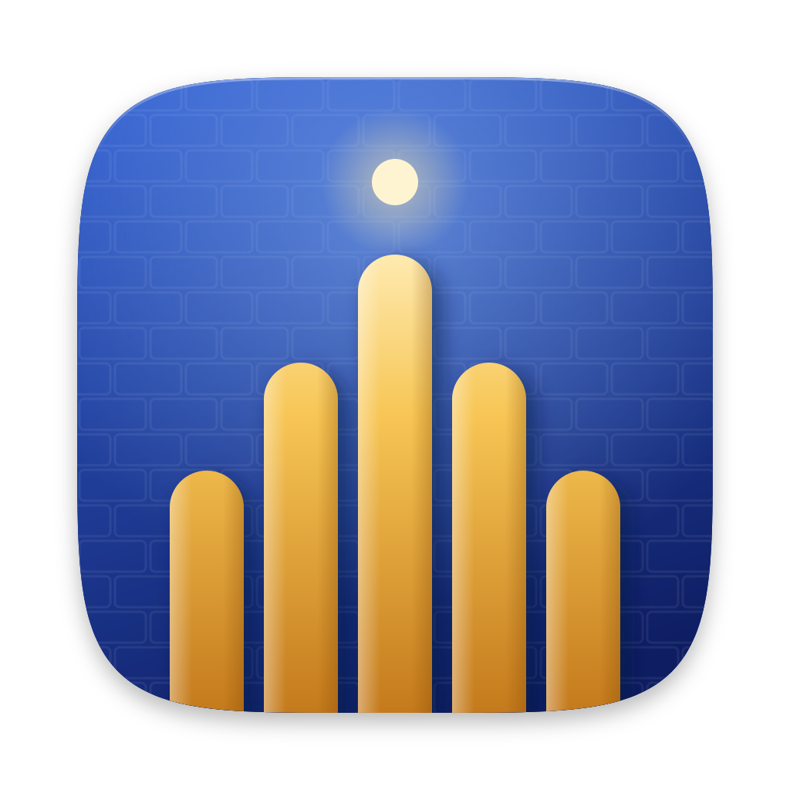

# BabelVoice

macOS 上的 AI 实时会议同传。

- **说话**：把你说的话实时翻译成对方的语言，通过 BabelVoice 虚拟音频设备送进会议软件，对方直接听到译音。
- **收听**：把会议里其他人说的话实时翻译成字幕，也可以播放译音给你听。

翻译引擎可选豆包同声传译、通义千问（Qwen）、Gemini、OpenAI，用你自己的 API Key，开箱即用，不需要注册账号。Key 用系统钥匙串加密保存在本机，会议记录也只存在本地。

## 下载安装

到 [Releases](https://github.com/ljhao24/babelvoice/releases) 下载最新的 `BabelVoice-<版本>-arm64.dmg`，拖进「应用程序」即可。安装包已经过 Apple 签名和公证。

要求：Apple 芯片的 Mac，macOS 14 或更新。

## 快速上手：以通义千问为例

### 1. 申请 API Key

1. 登录阿里云（没有账号先注册），打开百炼控制台的 [API Key 页面](https://bailian.console.aliyun.com/cn-beijing/model/settings/api-key)。第一次进入时同意服务协议，系统会自动开通百炼。
   - **新用户有大量免费额度**：开通后，许多模型会各自获得一份新人免费额度（通常 100 万 Token），BabelVoice 用的同传模型 `qwen3.8-livetranslate-flash-realtime` 也有 100 万 Token，90 天内有效，只在华北2（北京）地域提供，一般两小时内到账。详见[新人免费额度说明](https://help.aliyun.com/zh/model-studio/new-free-quota)。
   - 领取和使用免费额度不需要实名认证。额度用完后想继续用，需要先完成实名认证，之后按量计费。不想被意外扣费，可以在控制台的「免费额度」页打开「免费额度用完即停」。
2. 确认页面右上角的地域是「华北2（北京）」。BabelVoice 连接的是北京地域的服务，其他地域的 Key 用不了。
3. 点「创建 API Key」：归属业务空间保持「默认业务空间」，权限选「全部」，确定后复制这个以 `sk-` 开头的 Key。

### 2. 完成首次引导

打开 BabelVoice，跟着引导走完 6 步：

1. **安装驱动**：点「安装」，在系统弹窗里输入开机密码。这会添加一个名为 BabelVoice 的虚拟音频设备，你的译音通过它送进会议。
2. **授予权限**：依次给「麦克风」和「屏幕录制」点「授权」。macOS 把系统音频归在屏幕录制权限下，收听对方需要它；如果是在系统设置里授权的，要完全退出 BabelVoice 再重新打开才生效。
3. **配置服务**：选「通义千问」，把刚才的 Key 粘贴到「API Key」，「业务空间 ID」留空，点「保存并测试连接」。看到「连接正常，密钥可用」就配好了。
4. **测试说话**：点「开始说话」，说一句中文，扬声器会播放英文译音。
5. **测试聆听**：点「开始测试」，会播放一段英文示例，下方出现中文字幕。
6. **完成**：点「进入应用」。

### 3. 在会议里使用

1. 在 Zoom、腾讯会议、飞书、Teams 等会议软件的音频设置里，把**麦克风**选成 **BabelVoice**，扬声器照常选你的耳机或扬声器。
2. 先打开会议软件，再到 BabelVoice 的「会议」页选好「你说」和「对方说」的语言，把「收听来源」选成会议软件（这样只翻译会议里的声音），然后点「开始会议」。这些选项只在会议开始前能改。
3. **让对方听懂你**：点「翻译你说的话」里的「开始翻译」，或按 <kbd>⌥ Option</kbd> + <kbd>Space</kbd>，对方会在会议里听到你说话的译音；再按一次停止。
4. **听懂对方**：点「听懂对方在说什么」里的「开始聆听」，对方的话会实时显示在字幕浮窗里。
5. 开完点「结束会议」。对话自动保存，可以在「历史」里回看；每场会议的用量和预估费用在「会议监视」里查看。

更多设置（音频路由、收听来源、未翻译时麦克风直通、排错）见 [`docs/SETUP-macOS.md`](docs/SETUP-macOS.md)。其他服务商的配置流程相同，只是第 1 步换成各自的控制台。

## 从源码运行

```bash
npm install
npm run dev
```

需要 Xcode 命令行工具（编译原生音频模块）。其他常用命令：

```bash
npm run typecheck
npm test
npm run build:mac   # 打 DMG，签名与发布流程见 docs/RELEASE-macOS.md
```

## 目录结构

```
src/
  main/        # Electron 主进程：会话、翻译引擎客户端、音频路由、IPC
  preload/     # contextBridge
  renderer/    # React UI：控制面板 + 字幕悬浮窗
  core/        # 与平台/UI 无关的纯逻辑
  shared/      # 主进程与渲染进程共享的类型和文案
native/        # macOS 原生音频模块（麦克风、系统音频采集、播放）
protos/        # 豆包同声传译 protobuf 定义
docs/          # 配置指南、发布流程、架构决策（adr/）
```

## 许可证

[GPL-3.0](LICENSE)。随附的 BabelVoice 虚拟音频驱动基于 [BlackHole](https://github.com/ExistentialAudio/BlackHole)（GPL-3.0）。
