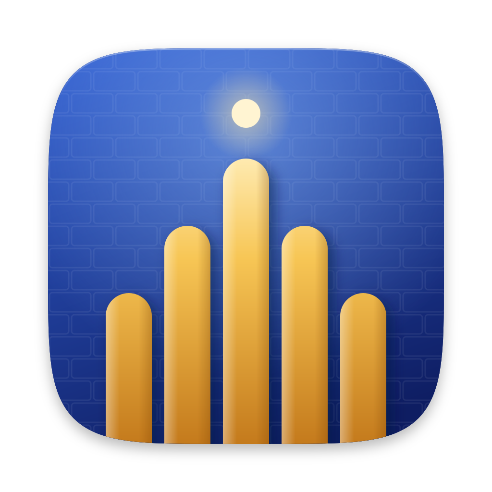

# BabelVoice

macOS 和 Windows 上的 AI 实时会议同传。

- **说话**：把你说的话实时翻译成对方的语言，通过虚拟音频设备送进会议软件（macOS 用 BabelVoice 自带驱动，Windows 用 VB-Cable），对方直接听到译音。
- **收听**：把会议里其他人说的话实时翻译成字幕，也可以播放译音给你听。

翻译引擎可选豆包同声传译、通义千问（Qwen）、Gemini、OpenAI，用你自己的 API Key，开箱即用，不需要注册账号。Key 用系统钥匙串加密保存在本机，会议记录也只存在本地。

## 下载安装

到 [Releases](https://github.com/ljhao24/babelvoice/releases) 下载最新的 `BabelVoice-<版本>-arm64.dmg`，拖进「应用程序」即可。安装包已经过 Apple 签名和公证。

要求：Apple 芯片的 Mac，macOS 14 或更新。

Windows 版目前需要从源码打包，见下面的「[Windows 使用说明](#windows-使用说明)」。

## 快速上手：以通义千问为例

### 1. 申请 API Key

1. 登录阿里云（没有账号先注册），打开百炼控制台的 [API Key 页面](https://bailian.console.aliyun.com/cn-beijing/model/settings/api-key)。第一次进入时同意服务协议，系统会自动开通百炼。
   - **新用户有大量免费额度**：开通后，许多模型会各自获得一份新人免费额度（通常 100 万 Token），BabelVoice 用的同传模型 `qwen3.8-livetranslate-flash-realtime` 也有 100 万 Token，90 天内有效，只在华北2（北京）地域提供，一般两小时内到账。详见[新人免费额度说明](https://help.aliyun.com/zh/model-studio/new-free-quota)。
   - 领取和使用免费额度不需要实名认证。额度用完后想继续用，需要先完成实名认证，之后按量计费。不想被意外扣费，可以在控制台的「免费额度」页打开「免费额度用完即停」。
2. 确认页面右上角的地域是「华北2（北京）」。BabelVoice 连接的是北京地域的服务，其他地域的 Key 用不了。
3. 点「创建 API Key」：归属业务空间保持「默认业务空间」，权限选「全部」，确定后复制这个以 `sk-` 开头的 Key。

### 2. 完成首次引导

打开 BabelVoice，跟着引导走完 6 步：

1. **安装驱动**：点「安装」，在系统弹窗里输入开机密码。这会添加一个名为 BabelVoice 的虚拟音频设备，你的译音通过它送进会议。
2. **授予权限**：依次给「麦克风」和「屏幕录制」点「授权」。macOS 把系统音频归在屏幕录制权限下，收听对方需要它；如果是在系统设置里授权的，要完全退出 BabelVoice 再重新打开才生效。
3. **配置服务**：选「通义千问」，把刚才的 Key 粘贴到「API Key」，「业务空间 ID」留空，点「保存并测试连接」。看到「连接正常，密钥可用」就配好了。
4. **测试说话**：点「开始说话」，说一句中文，扬声器会播放英文译音。
5. **测试聆听**：点「开始测试」，会播放一段英文示例，下方出现中文字幕。
6. **完成**：点「进入应用」。

### 3. 在会议里使用

1. 在 Zoom、腾讯会议、飞书、Teams 等会议软件的音频设置里，把**麦克风**选成 **BabelVoice**，扬声器照常选你的耳机或扬声器。
2. 先打开会议软件，再到 BabelVoice 的「会议」页选好「你说」和「对方说」的语言，把「收听来源」选成会议软件（这样只翻译会议里的声音），然后点「开始会议」。这些选项只在会议开始前能改。
3. **让对方听懂你**：点「翻译你说的话」里的「开始翻译」，或按 <kbd>⌥ Option</kbd> + <kbd>Space</kbd>，对方会在会议里听到你说话的译音；再按一次停止。
4. **听懂对方**：点「听懂对方在说什么」里的「开始聆听」，对方的话会实时显示在字幕浮窗里。
5. 开完点「结束会议」。对话自动保存，可以在「历史」里回看；每场会议的用量和预估费用在「会议监视」里查看。

更多设置（音频路由、收听来源、未翻译时麦克风直通、排错）见 [`docs/SETUP-macOS.md`](docs/SETUP-macOS.md)。其他服务商的配置流程相同，只是第 1 步换成各自的控制台。

## Windows 使用说明

要求：Windows 10 或 11（64 位）。「只收听某个会议软件」和「播放对方的译音」需要 Windows 11，或 Windows 10 build 20348 以上。

### 1. 打包安装

目前没有现成的 Windows 安装包，需要自己打包一次。先准备：

- [Node.js](https://nodejs.org/) 20 或更新、[Git for Windows](https://git-scm.com/download/win)（自带 Git Bash，构建脚本要用）、Python 3
- Visual Studio 2022 Build Tools，勾选「使用 C++ 的桌面开发」（编译原生音频模块）

然后在 Git Bash 里运行：

```bash
npm install
npm run build:win
```

`dist/` 下会生成两个文件，任选其一：

- `BabelVoice-Setup-<版本>-x64.exe`：安装版
- `BabelVoice-<版本>-x64-portable.exe`：免安装版，双击即用

安装包没有签名，首次运行 Windows 会弹出 SmartScreen 提示，点「更多信息 → 仍要运行」即可。

### 2. 安装 VB-Cable 虚拟声卡

Windows 版用免费的 [VB-Cable](https://vb-audio.com/Cable/) 把译音送进会议软件。下载后解压，右键 `VBCABLE_Setup_x64.exe` →「以管理员身份运行」→ Install Driver。装好后系统里多出两个设备：

| 设备 | 用途 |
| --- | --- |
| CABLE Input | BabelVoice 把译音播到这里。**不要**把它设为系统默认输出 |
| CABLE Output | 会议软件把它选作**麦克风** |

VB-Cable 安装程序有时会把 CABLE Input 设成系统默认输出，装完记得到「设置 → 系统 → 声音 → 输出」改回你的耳机或扬声器。

### 3. 首次引导

和 macOS 一样走 6 步，区别是：

- **第 1 步**检测 VB-Cable，装好后几秒内自动识别。
- **第 2 步**只需确认「设置 → 隐私和安全性 → 麦克风」里允许桌面应用访问麦克风，Windows 采集会议声音不需要额外授权。
- **第 3 步**选好服务后，一定要点「保存并测试连接」，看到「连接正常」再点「下一步」，否则 Key 不会保存。
  - 豆包：火山「豆包语音」新版控制台只给一个 API Key，填第一栏即可；旧版控制台的 APP ID 和 Access Token 填后两栏。

### 4. 设备怎么选

| 在哪里 | 选什么 |
| --- | --- |
| Windows 默认输出 | 你的耳机或扬声器 |
| Windows 默认输入 | 你的真实麦克风（BabelVoice 用它收你的声音） |
| 会议软件的麦克风 | **CABLE Output** |
| 会议软件的扬声器 | 耳机或扬声器（不要选 CABLE Input） |

用蓝牙耳机时，建议只用它听、用电脑或有线麦克风说话。一旦有程序用蓝牙耳机的麦克风，耳机会切到通话模式（设备名带 Hands-Free），音质会明显变差。

### 5. 在会议里使用

- **让对方听懂你**：开始会议后按快捷键（默认 <kbd>Alt</kbd> + <kbd>Space</kbd>）开始或停止翻译。这个组合键和 Windows 的窗口菜单冲突，建议在设置里换一个。
- **听懂对方**：「收听来源」选会议软件（只翻译它的声音），对方的话会显示在字幕浮窗里。想直接听中文译音，再打开「播放对方的译音」，译音只在你本机播放，对方听不到。

更多设置和排错见 [`docs/SETUP-windows.md`](docs/SETUP-windows.md)。

## 从源码运行

```bash
npm install
npm run dev
```

macOS 需要 Xcode 命令行工具，Windows 需要 Visual Studio 2022 Build Tools 并在 Git Bash 里运行（编译原生音频模块）。其他常用命令：

```bash
npm run typecheck
npm test
npm run build:mac   # 打 DMG，签名与发布流程见 docs/RELEASE-macOS.md
npm run build:win   # 打 Windows 安装包和免安装版
```

## 目录结构

```
src/
  main/        # Electron 主进程：会话、翻译引擎客户端、音频路由、IPC
  preload/     # contextBridge
  renderer/    # React UI：控制面板 + 字幕悬浮窗
  core/        # 与平台/UI 无关的纯逻辑
  shared/      # 主进程与渲染进程共享的类型和文案
native/        # 原生音频模块（麦克风、系统音频采集、播放）；Windows 实现在 native/win/
protos/        # 豆包同声传译 protobuf 定义
docs/          # 配置指南、发布流程、架构决策（adr/）
```

## 许可证

[GPL-3.0](LICENSE)。随附的 BabelVoice 虚拟音频驱动基于 [BlackHole](https://github.com/ExistentialAudio/BlackHole)（GPL-3.0）。
